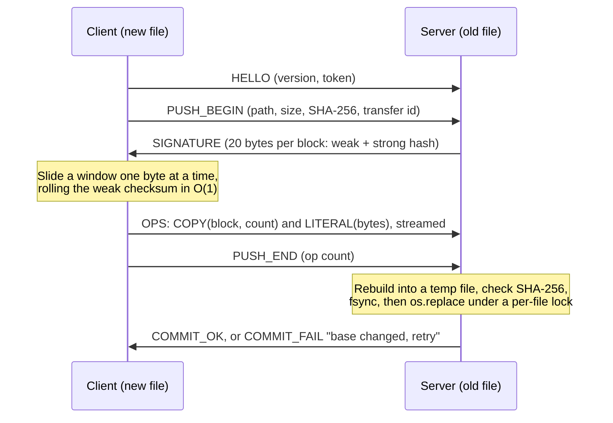
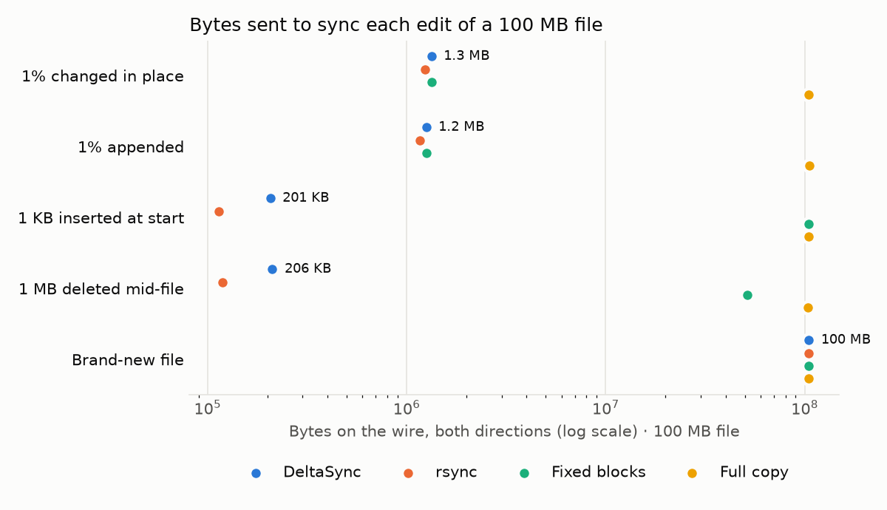
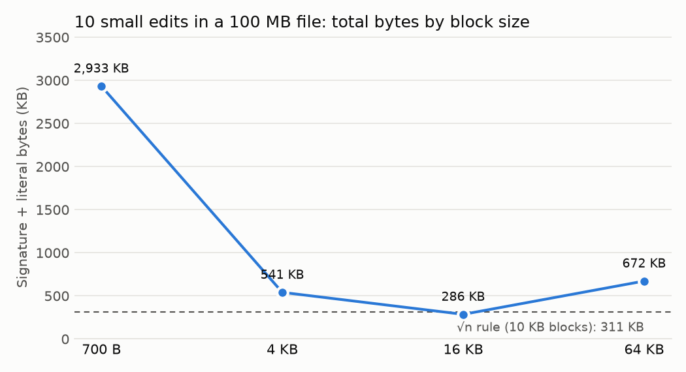
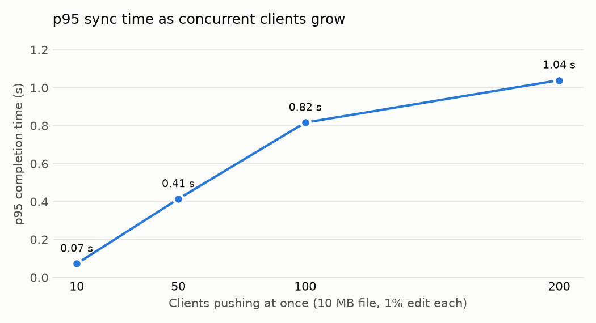

# DeltaSync

An rsync-style file sync engine built from scratch: a rolling checksum finds unchanged blocks at any offset, so an edit anywhere in a file, even an insertion that shifts every later byte, sends only the changed data. An asyncio server handles many clients without a thread each, resumes dropped pushes, and never leaves a half-written file. The hot loop runs in C++ through pybind11 with the GIL released.

Every number below is regenerated from `bench/results/*.csv` by `python -m bench.report`; CI fails if they drift.

## How a push works



1. **Signature** (server, old file): one 20-byte entry per block, a 4-byte rsync weak checksum plus a 16-byte XXH3-128 hash. The block size is about √(file size), clamped to 1–64 KB.
2. **Delta** (client, new file): slide a block-sized window one byte at a time. On a weak-hash hit, compute the strong hash; a match emits COPY and jumps a block, otherwise the byte joins the current literal run. Consecutive COPYs merge into runs, so an unchanged file is one op.
3. **Patch** (server): replay the ops into a fresh temp file, check SHA-256, fsync, and `os.replace` it over the target.

A brand-new file gets an empty signature, so a full upload is just a delta of all literals. Pull is the mirror image: the client sends the signature and the server streams the ops.

### Design choices

| Problem | What DeltaSync does |
| --- | --- |
| An insertion shifts every later block | The rolling checksum tests every offset, so shifted blocks still match |
| Patching in place leaves stale bytes when the new file is shorter | Ops are replayed into a fresh temp file, never over the old one |
| Acknowledging every block caps throughput at one block per round trip | Ops stream with one acknowledgement at the end; `drain()` gives backpressure |
| One `recv()` can return half a message or two | Length-prefixed frames read with `readexactly()`; frames over 1 MiB are refused |
| Client paths like `../x` escape the storage folder | Paths with `..`, absolute paths, NUL bytes and symlinks out of the root are rejected |
| Two clients push the same file at once | Per-transfer temp files; at commit, a per-file lock and a base check (inode, size, mtime) make the loser fail with "base changed, retry" |
| A crash mid-commit | Temp file, fsync, atomic `os.replace`, then fsync the directory: readers see the old file or the new one |
| A dropped connection mid-push | A journal records the last durable offset; RESUME continues from there |
| Delta work blocks the event loop | Signature and delta work run in a thread pool; the C++ core releases the GIL |

## Quick start

Requires Python 3.12+, a C++17 compiler and the Python development headers.

```bash
python -m venv .venv && .venv/bin/pip install -e ".[test,bench]"
```

```bash
export DELTASYNC_TOKEN=change-me
deltasync serve --root ./store --port 5001 --metrics-port 9100
```

```bash
deltasync push ./big.bin big.bin
```

```bash
deltasync pull big.bin ./big.bin
```

Offline tools, used by the tests and benchmarks:

```bash
deltasync sig old.bin old.sig
```

```bash
deltasync delta old.sig new.bin patch.dlt
```

```bash
deltasync patch old.bin patch.dlt out.bin
```

A small dashboard reads the server's Prometheus metrics:

```bash
python -m deltasync.dashboard.app --metrics http://127.0.0.1:9100/metrics
```

`DELTASYNC_ENGINE=python` forces the pure-Python reference engine instead of the C++ core.

## Testing

```bash
.venv/bin/pytest
```

```bash
HYPOTHESIS_PROFILE=thorough .venv/bin/pytest
```

The default run uses 200 Hypothesis examples per property; the thorough profile uses 10,000. [docs/VERIFICATION.md](docs/VERIFICATION.md) maps every check to its test.

| Layer | Test type | What it checks |
| --- | --- | --- |
| Rolling checksum | Unit, property | Rolling forward from any offset equals recomputing; matches the rsync paper's formula |
| Delta engine | Property (Hypothesis) | `patch(old, delta(sig(old), new)) == new` for random files and edit scripts, plus empty, tiny, identical, unrelated, all-zero, short-tail and shrinking files |
| C++ core | Differential | C++ and Python emit identical signatures and op streams; threads run in parallel |
| Framing | Unit | A frame split across reads, several frames in one read, oversized frames refused |
| Server | Integration | Push and pull end to end, auth, 50 concurrent pushes, racing pushes, a responsive event loop under load, idle timeout, metrics |
| Paths | Security | `..`, absolute paths, NUL bytes and symlinks out of the root are rejected |
| Faults | Fault injection | Connection cut at the proxy, client killed, server killed mid-push and mid-commit: the target is always the old file or the new one |

CI runs the suite on both engines, checks that the C++ core built, and runs a 10 MB smoke benchmark.

## Results

<!-- results:start -->
Measured on 13th Gen Intel(R) Core(TM) i5-13450HX, Python 3.14.6, commit `a6da8e0-dirty`. Medians of 5 runs.

### Bytes on the wire by edit pattern

**100 MB file**, bytes on the wire in both directions (% of the new file's size):

| Edit | DeltaSync | rsync | Fixed blocks | Full copy |
| --- | --- | --- | --- | --- |
| 1% changed in place | 1.3 MB (1.27%) | 1.2 MB (1.18%) | 1.3 MB (1.27%) | 100.0 MB (100.00%) |
| 1% appended | 1.2 MB (1.18%) | 1.1 MB (1.10%) | 1.2 MB (1.18%) | 101.0 MB (100.00%) |
| 1 KB inserted at start | 201.4 KB (0.20%) | 111.4 KB (0.11%) | 100.2 MB (100.25%) | 100.0 MB (100.00%) |
| 1 MB deleted mid-file | 206.5 KB (0.20%) | 116.0 KB (0.11%) | 49.2 MB (49.72%) | 99.0 MB (100.00%) |
| Brand-new file | 100.0 MB (100.01%) | 100.0 MB (100.03%) | 100.1 MB (100.05%) | 100.0 MB (100.00%) |

**10 MB file**, bytes on the wire in both directions (% of the new file's size):

| Edit | DeltaSync | rsync | Fixed blocks | Full copy |
| --- | --- | --- | --- | --- |
| 1% changed in place | 196.7 KB (1.92%) | 164.5 KB (1.61%) | 196.8 KB (1.92%) | 10.0 MB (100.00%) |
| 1% appended | 167.2 KB (1.62%) | 135.6 KB (1.31%) | 167.4 KB (1.62%) | 10.1 MB (100.00%) |
| 1 KB inserted at start | 64.7 KB (0.63%) | 33.0 KB (0.32%) | 10.1 MB (100.78%) | 10.0 MB (100.00%) |
| 1 MB deleted mid-file | 67.4 KB (0.73%) | 32.5 KB (0.35%) | 4.1 MB (45.21%) | 9.0 MB (100.00%) |
| Brand-new file | 10.0 MB (100.01%) | 10.0 MB (100.03%) | 10.0 MB (100.16%) | 10.0 MB (100.00%) |



### Block size (100 MB file, 10 scattered 100-byte edits)

| Block size | Total on the wire | Of which literal data |
| --- | --- | --- |
| 700 B | 2.9 MB | 6.8 KB |
| 4 KB | 540.6 KB | 40.0 KB |
| 16 KB | 285.6 KB | 160.0 KB |
| 64 KB | 671.9 KB | 640.0 KB |
| √n rule (10 KB) | 310.6 KB | 110.0 KB |



### Delta speed: Python reference vs C++ core

| File (1% changed in place) | Python | C++ | Speed-up |
| --- | --- | --- | --- |
| 100 MB | 67 MB/s | 2,244 MB/s | 33.5× |
| 1 GB | 67 MB/s | 2,222 MB/s | 33.2× |

### Concurrency (each client pushes a 10 MB file with a 1% edit)

| Clients at once | p95 completion | File data synced per second | Server peak memory |
| --- | --- | --- | --- |
| 10 | 0.07 s | 1,382 MB/s | 112 MB |
| 50 | 0.41 s | 1,207 MB/s | 136 MB |
| 100 | 0.82 s | 1,224 MB/s | 165 MB |
| 200 | 1.04 s | 1,919 MB/s | 240 MB |



### 50 ms round trip (100 MB file, 1% edit)

| Tool | Wall-clock sync time | Bytes on the wire |
| --- | --- | --- |
| DeltaSync | 0.49 s | 1.3 MB |
| rsync | 0.51 s | 1.2 MB |

### Resume (100 MB new file, cut at 50%)

| After reconnecting | Bytes re-sent | % of file |
| --- | --- | --- |
| With resume | 52.0 MB | 52% |
| Without resume | 100.0 MB | 100% |
<!-- results:end -->

### How these were measured

- Bytes are counted at a TCP relay ([bench/count_proxy.py](bench/count_proxy.py)), never from the program's own estimate, and include both directions.
- Five runs per configuration on a warm page cache; the CSVs keep every run plus the median, with CPU model, Python version and commit hash on each row.
- rsync runs as a local daemon with `--stats --no-whole-file`, so it does real delta transfer.
- The test machine has no root, Docker or SSH server, which forced three substitutions:
  - The full-copy baseline is a raw TCP send of the file, not `scp`.
  - The 50 ms round trip is added inside the relay instead of with `tc netem`, so packet loss is not emulated.
  - Edit patterns use 10 MB and 100 MB files; the 1 GB file appears only in the delta-speed test.

Reproduce everything (needs `rsync`; writes about 2 GB of test files to `bench/data/`):

```bash
python -m bench.make_files --sizes 10 100
```

```bash
python -m bench.baseline && python -m bench.run_bench all
```

```bash
python -m bench.plots && python -m bench.report
```

## Repo layout

```text
deltasync/
├── core/        Python reference: rolling.py, signature.py, delta.py, patch.py, engine.py
├── native_src/  C++17 core (core.hpp), pybind11 bindings, vendored xxhash.h
├── native.py    The C++ core behind the Python API
├── protocol/    frames.py, messages.py, stream.py
├── server/      server.py (asyncio), storage.py (paths, locks, journal), metrics.py
├── client/      client.py (push, pull, resume), cli.py
└── dashboard/   Flask app
bench/           make_files, count_proxy, baseline, run_bench, plots, report; results/*.csv
tests/           core, protocol, server, native, faults, bench
```
